<div align="center">


# Chief Rice Trader

**Sales, stock and khata (credit) management for a rice wholesale and retail store in Pakistan.**

[**Live site: chiefrice.co**](https://chiefrice.co)


</div>

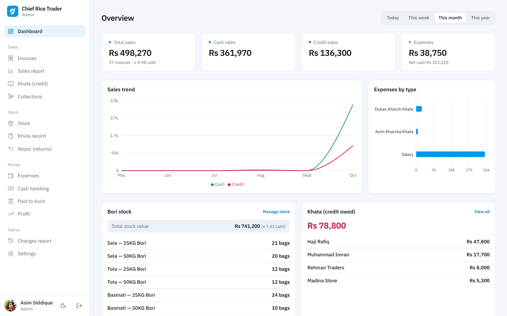

## About

Chief Rice Trader replaces the paper khata and stock register of a rice shop with one web app.
The owner (admin) and the salesman each get their own panel. Every bill, bori (bag), loose
(khula) sale, credit customer, expense, return and cash handover is recorded, so the owner can
see sales, stock, money in the store and real profit at any time, from a phone or a computer.

Built by [Yaeesh Babar](https://www.yaeesh.work) (Black Hole Matrix) for Asim Siddique's rice
business.

## Features

**Selling**
- Sell **khula** (loose rice by weight) and **bori** (25 KG / 50 KG bags) on the same bill
- Several bills open at once, one tab per waiting customer
- Cash, online transfer or **credit (khata)** payments
- Online payments record exactly where the money landed, e.g. **Asim Account (UBL)** or
  **Asim Account (Faysal Bank)**, because the business uses several banks
- Print an **A4 invoice** or an **80mm thermal receipt**
- Edit or cancel a bill with a reason; the full history stays in the **Changes report**

**Stock**
- Main stock of bori per rice type and size, with purchase price and stock value
- **Khula per rice type**: every opened bori of a type is added together, e.g. a 25 KG and a
  50 KG bori of Banaspati show as 75 KG. Sales take from the oldest lot first
- Each bori is **weighed when opened**: khula gets the real weight (e.g. 24,700 g) and the
  missing 300 g is recorded as shortfall
- Loose rice that is already open (e.g. 10 KG outside a bori) can be added straight to khula
- An animated container for each rice type shows how much khula is left
- **End a batch** early when the khula is finished in real life: whatever the system still shows
  (e.g. 750 g) is recorded as shortfall. The Khula record shows both kinds of shortfall
- **Wapsi** (returns) put rice back into stock or khula (a 4 KG return makes 75 KG into 79 KG)
  and refund cash or reduce the customer's khata

**Corrections, with a record of every change**
- Rename or delete a rice type (old bills and records are kept)
- Correct or delete a stock entry that was typed wrong, and fix a bori count after counting
- Put back a bori opened by mistake, undo a return, a cash handover or a commission handover
- Correct or delete a khata payment and edit customer details
- **Add, edit, delete or switch off** rice types, bank accounts and commission salesmen in Settings.
  A deleted bank account still shows on old bills; a commission salesman can only be deleted once
  nothing is owed to them
- Every change asks for a reason and shows in the **Changes report**: what changed, who did it and why

**Money**
- **Khata**: every credit customer's balance, bills and payments; record full or partial payments
- Add a creditor without a bill, with their old balance from the paper khata (warns if the same
  name or phone is already in the khata)
- **Expenses**: shop expenses, the owner's personal expenses and salaries
- **Cash handling**: what is in the counter and the salesman's account, and every handover to the owner
- **Paid to Asim**: every payment that reached the owner, one by one: each bank account, cash
  handed over and transfers from the salesman's account, with a total for each and for all together
- **Commission** for commission salesmen, worked out on profit, with payouts tracked
- **Profit** page made for the owner: one big profit (munafa) or loss (nuqsan) figure, a bar
  showing where the sales money went, then each step (rice cost, delivery, commission, expenses,
  salaries, returns, take-home), profit per rice type and per day. Today, this week, this month,
  this year or any dates

**General**
- Separate **admin** and **salesman** panels with role-based access
- The admin can **add logins**, rename them, switch a login off (it is signed out at once) and set
  a new password for any login; phones still using the old password are logged out
- Find any bill by its invoice number
- Clean, minimal interface with **light and dark** themes, works on mobile
- All dates and daily bill numbers follow **Pakistan time**

## Screenshots

| Dashboard | Dark mode |
| --- | --- |
|  | 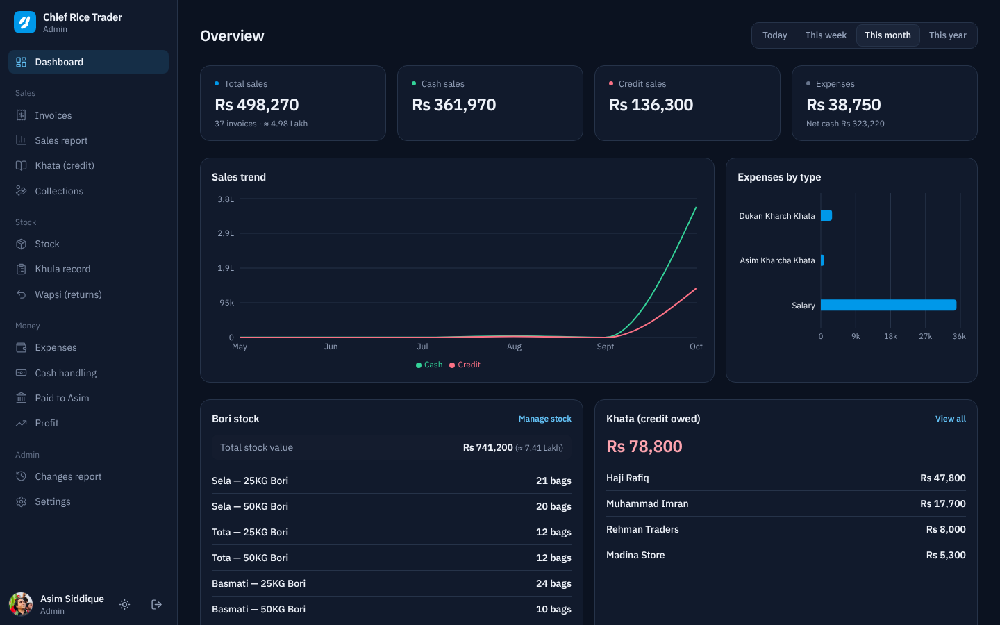 |
| **New sale (salesman)** | **Invoices with bank names** |
| 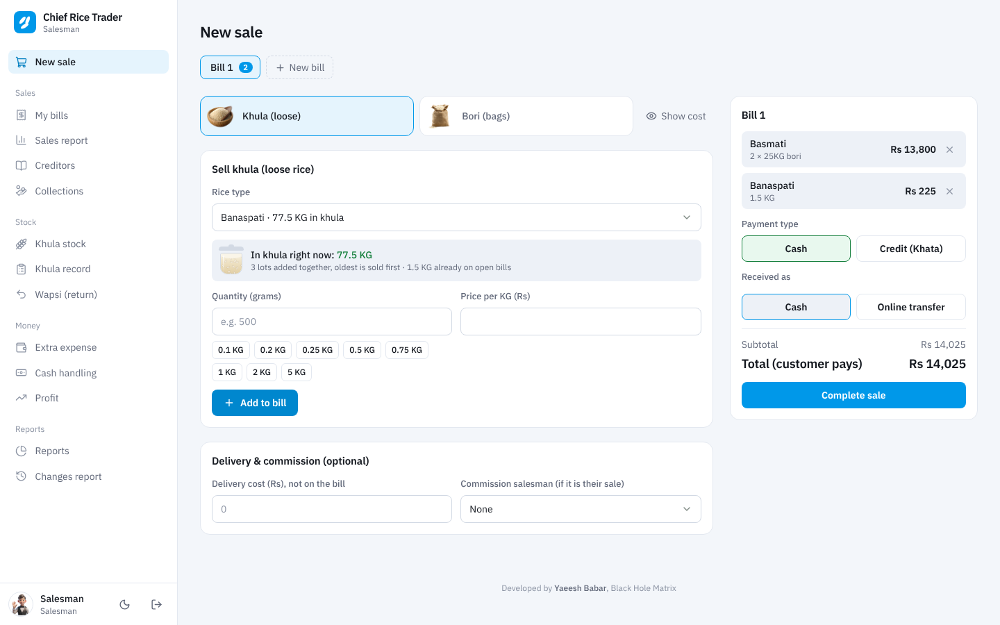 | 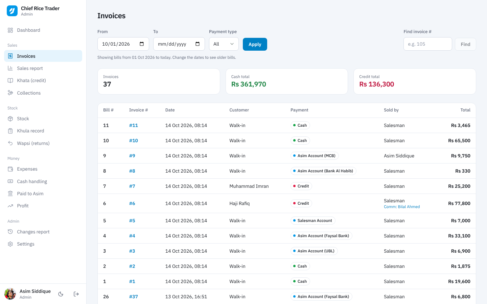 |
| **Invoice** | **Profit** |
| 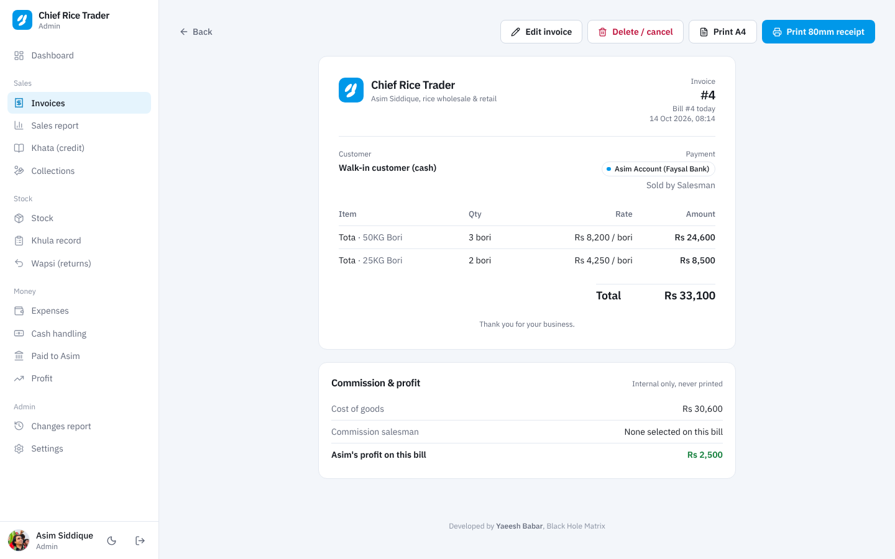 | 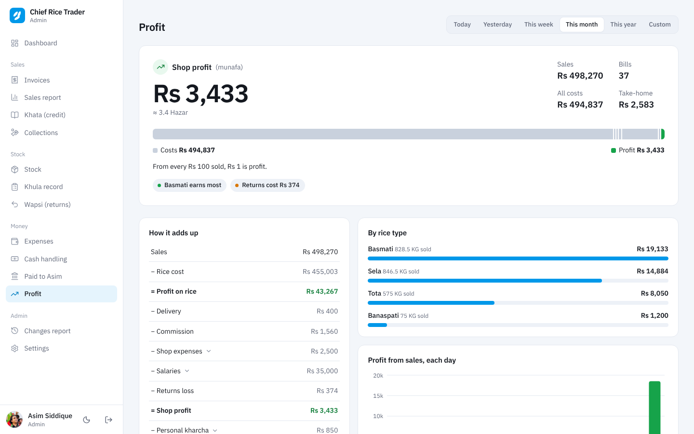 |
| **Paid to Asim** | **Stock** |
| 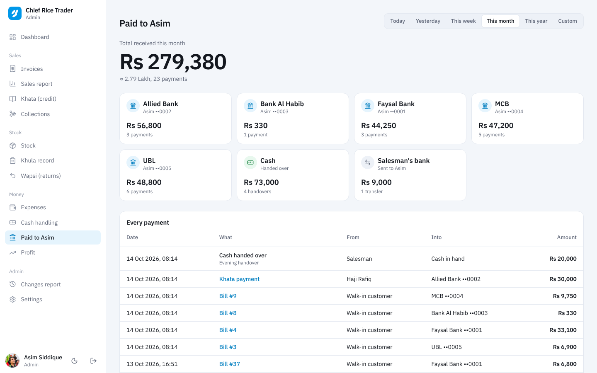 | 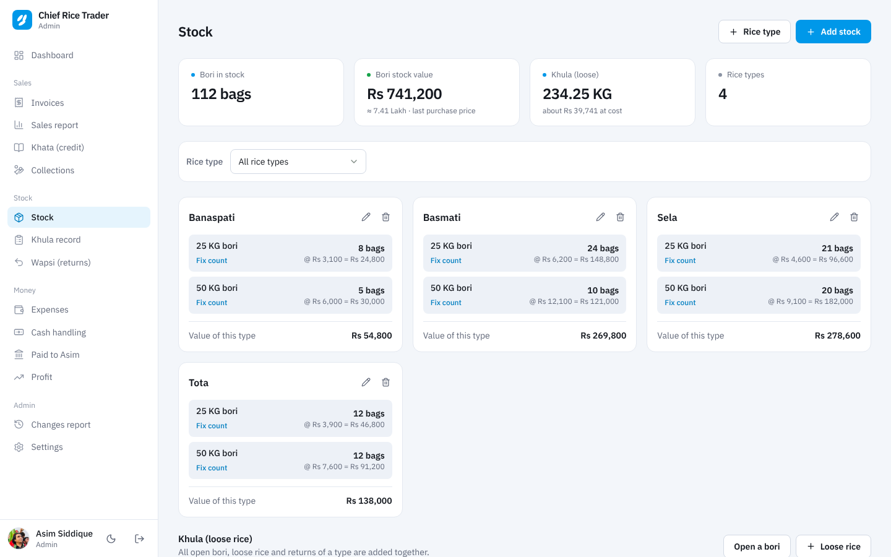 |
| **Khula containers** | **Changes report** |
| 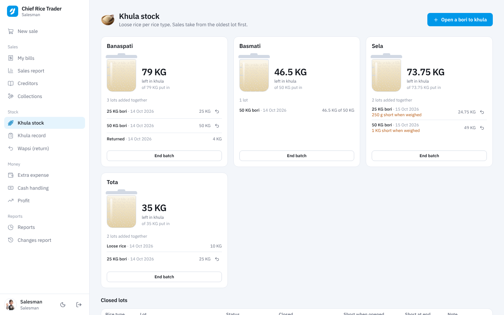 | 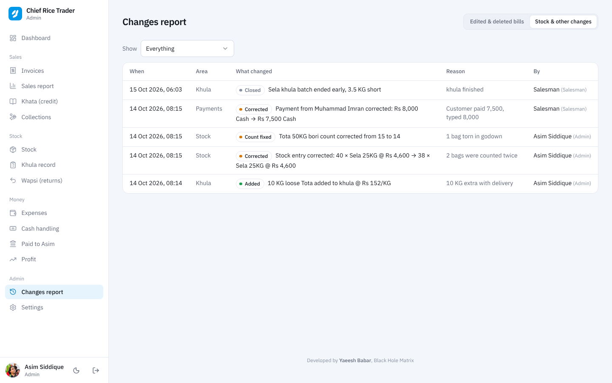 |
| **Sign in** | |
| 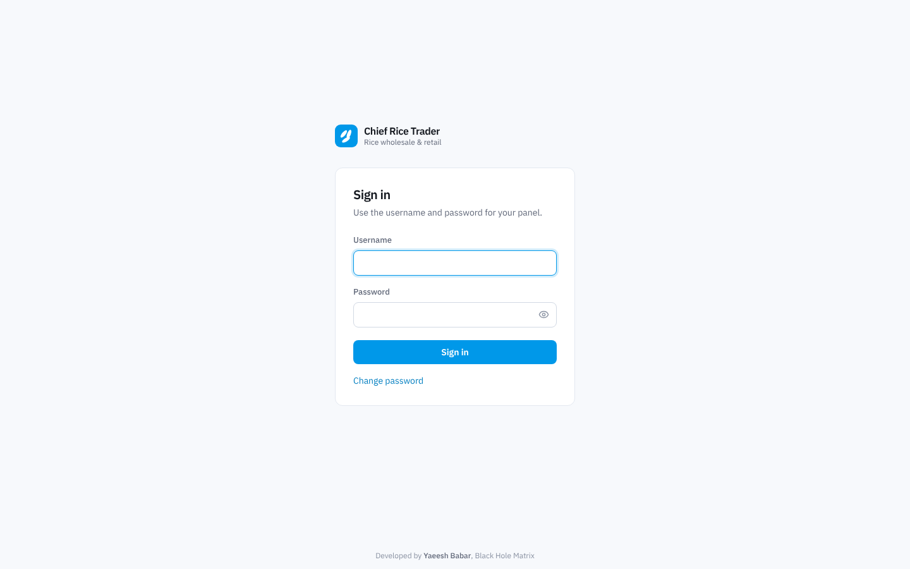 | |

<p align="center">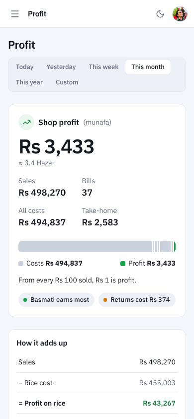</p>

## Tech stack

| Part | Technology |
| --- | --- |
| Frontend | React 19, React Router 7, Vite 8, Tailwind CSS 4, Recharts, Lucide icons, IBM Plex Sans |
| Backend | Node.js, Express 4, Mongoose 8, JWT authentication, bcrypt |
| Database | MongoDB Atlas |
| Hosting | Vercel (static frontend + Express API as a serverless function) |
| Domain | chiefrice.co |

## Project structure

```
chief-rice/
├── api/
│   └── index.js          Vercel serverless entry: runs the Express app for /api/*
├── client/               React frontend (Vite + Tailwind)
│   ├── public/
│   └── src/
│       ├── components/   Layout, modals, receipt, shared UI
│       ├── context/      Auth, theme and open-bills state
│       ├── pages/        admin/, salesman/ and shared pages
│       └── utils/
├── server/               Express + MongoDB API
│   ├── config/           Database connection, time zone
│   ├── controllers/
│   ├── middleware/
│   ├── models/
│   ├── routes/
│   └── utils/            Seed, launch reset and profit repair scripts
├── screenshots/          Images used in this README
├── vercel.json           Build, output folder and routing for Vercel
└── package.json          npm workspaces (client + server)
```

## Run it locally

You need **Node.js 20.19+ or 22.12+** and a **MongoDB** database (a free MongoDB Atlas cluster works).

```bash
git clone https://github.com/yaeeshbabar/chief-rice.git
cd chief-rice
npm install
```

Create `server/.env` from the example and fill in your values:

```bash
cp server/.env.example server/.env
```

Create the logins and default data (first time only, on an empty database):

```bash
npm run seed
```

Start the API (port 5000) and the frontend (port 5173) together:

```bash
npm run dev
```

Then open http://localhost:5173.

## Environment variables

Set these in `server/.env` for local development, and in **Vercel > Settings > Environment Variables** for the live site.

| Variable | Required | What it is |
| --- | --- | --- |
| `MONGO_URI` | Yes | MongoDB connection string, including the database name |
| `JWT_SECRET` | Yes | Long random string used to sign logins |
| `JWT_EXPIRES_IN` | No | How long a login lasts (default `7d`) |
| `PORT` | No | Local API port (default `5000`, not used on Vercel) |
| `SEED_ADMIN_PASSWORD` | Seed only | Password for the admin login created by `npm run seed` |
| `SEED_SALESMAN_PASSWORD` | Seed only | Password for the salesman login created by `npm run seed` |
| `APP_TIMEZONE` | No | Time zone for days and reports (default `Asia/Karachi`) |

## Scripts

| Command | What it does |
| --- | --- |
| `npm run dev` | Runs the API and the frontend together in development mode |
| `npm run build` | Builds the frontend into `client/dist` |
| `npm start` | Runs the API only |
| `npm run seed` | Creates the two logins, default rice types and rent types, plus any bank accounts in `server/utils/seed-accounts.json` (kept off GitHub; see `seed-accounts.example.json`) |
| `npm run reset-launch` | Shows what test data exists. Add `-- --yes` to clear bills, customers, payments, expenses, returns, stock movements and change records while keeping logins and settings |
| `npm run fix-profit` | Recalculates cost, profit and commission on existing bills from current prices |

## Deployment

The whole app runs as **one Vercel project**:

- `npm run build` creates the React app in `client/dist`, which Vercel serves as static files.
- `api/index.js` wraps the same Express app used locally, so every `/api/...` request runs as a
  serverless function. The MongoDB connection is reused between requests.
- `vercel.json` sends `/api/*` to the function and every other path to the React app.

To deploy your own copy: import the repository in Vercel, add the environment variables above,
allow Vercel to reach MongoDB Atlas (Network Access: `0.0.0.0/0`), and deploy. The custom domain
is added under **Settings > Domains**.

## Author

**Yaeesh Babar**: MERN stack full stack developer, founder of Black Hole Matrix (Lahore, Pakistan)

- Website: [yaeesh.work](https://www.yaeesh.work)
- GitHub: [@yaeeshbabar](https://github.com/yaeeshbabar)
- LinkedIn: [Yaeesh Babar](https://www.linkedin.com/in/yaeesh-babar-516bab28a/)
- Email: [yaeeshbabar@gmail.com](mailto:yaeeshbabar@gmail.com)

## License

Client project built by Black Hole Matrix. All rights reserved.
